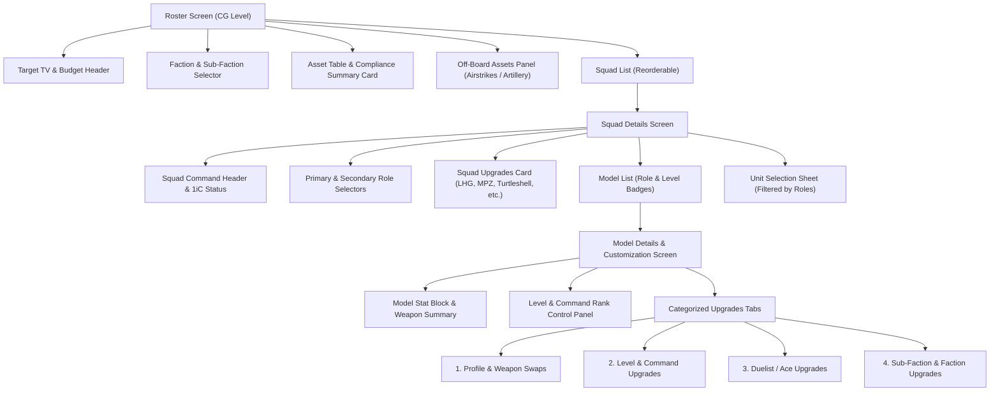

# Heavy Gear Blitz 4.0 Construction Rules UI Design Document

This document evaluates the **Heavy Gear Blitz 4.0 Rules** against the existing **Gearforce** layouts and presents a visual UI design supporting full 4.0 construction rules across mobile, tablet, and desktop viewports.

---

## 1. Rule Evaluation & Gap Analysis

The table below details how the Heavy Gear Blitz 4.0 Construction Rules compare to the current Gearforce layout implementation.

| Rule Category                  | Heavy Gear 4.0 Requirement                                                     | Current Gearforce State                                                  | UI Design Fix / Enhancements                                                            |
|--------------------------------|--------------------------------------------------------------------------------|--------------------------------------------------------------------------|-----------------------------------------------------------------------------------------|
| **Target TV & Roster Budget**  | Force built to agreed Target TV limit (e.g. 100 TV).                           | Displays total TV only. No target limit or budget tracker.               | Add Target TV selector, progress budget bar, TV remaining indicator, and alert.         |
| **Combat Group Leader (CGL)**  | Highest ranking officer (CO → XO → 1iC) designated CGL for initiative rolls.   | Command dropdown exists per model, but no CGL tracking or badge.         | Auto-calculate CGL based on hierarchy; show ⭐ **CGL Badge** on unit tile and summary.  |
| **Asset Table Validation**     | Limits on Vet/Elite Squads, Duelists, Green Squads, and Drones per Faction.    | Rules engine evaluates rules, but UI lacks asset limit visual feedback.  | Add **Faction Asset Table Card** showing `Used / Limit` counters (e.g. Vet: 1/2).       |
| **Core Off-Board Assets**      | Airstrike Counters (3 TV) and Artillery Strike Counters (4 TV) at CG level.    | No off-board asset selection interface.                                  | Add **Off-Board Assets Panel** to CG summary for adding/removing Airstrikes/Artillery.  |
| **Squad 1iC & 2iC Rules**      | 1iC required (+1 TV) & sets Primary Role. 2iC optional (+1 TV). CO/XO (+1 TV). | Basic `CommandLevelSelector` dropdown on model screen.                   | Elevate Command rank in Squad Header & Model Tiles; validate mandatory 1iC requirement. |
| **Squad Role Constraints**     | Primary role dictated by 1iC. Units must match Primary or Secondary role.      | Selectors exist, but no role mismatch warning on model list tiles.       | Filter selectable models by role; show `[ROLE MISMATCH]` warning chips on units.        |
| **Squad Size Boundaries**      | 4 to 9 units per standard squad (2-4 for Striders/Vehicles, etc.).             | Displays unit count without size constraint feedback.                    | Add squad size badge with status styling: Normal (Green), Warning (<4 or >9) (Amber).   |
| **Squad-Wide Upgrades**        | Grenades (LHG/MHG), Panzerfausts (LPZ/MPZ), Shaped Explosives, Turtleshell.    | Data models exist, but Squad Details Screen lacks Squad Upgrade section. | Add **Squad Upgrades Card** to Squad Details screen with checkboxes & TV calculations.  |
| **Unit Level Badges**          | Green (-1 TV), Regular (0 TV), Veteran (+1 TV), Elite (+2 TV), Duelist (+2 TV) | Dropdown on detail screen only.                                          | Add prominent chips on model cards: `[GREEN]`, `[VET]`, `[ELITE]`, `[DUELIST]`.         |
| **Categorized Model Upgrades** | Profile Swaps, Vet/Elite Upgrades, Duelist Upgrades, Sub-Faction Upgrades.     | Uncategorized single expansion list.                                     | Reorganize model upgrades into 4 distinct visual categories with stat change previews.  |

---

## 2. Information Architecture & Navigation Flow



---

## 3. UI Layout Directory Structure

```
docs/wireframes/
├── ui_design_construction_rules.md
├── navigation_flow.mmd
├── navigation_flow.svg
├── desktop_web/
│   ├── 01_roster_overview_desktop.svg
│   ├── 02_squad_details_desktop.svg
│   ├── 03_unit_customization_desktop.svg
│   └── 04_asset_compliance_center_desktop.svg
└── mobile_phone/
    ├── 01_roster_overview_phone.svg
    ├── 02_squad_details_phone.svg
    ├── 03_unit_customization_phone.svg
    └── 04_asset_compliance_sheet_phone.svg
```

---

## 4. Visual Component Tokens & Badge Specifications

### Command Badges
- ⭐ **CGL (Combat Group Leader)**: `Gold Star Chip / Amber Accent (#FFB300)` - Automatically placed on highest-ranking officer.
- 🛡️ **CO (Commanding Officer)**: `Gold Badge (#D4AF37)` - Highest rank (+2 TV total).
- 💫 **XO (Executive Officer)**: `Silver Badge (#C0C0C0)` - Second rank (+2 TV total).
- 🔰 **1iC (1st in Charge)**: `Blue Badge (#1976D2)` - Mandatory squad leader (+1 TV).
- 🔹 **2iC (2nd in Charge)**: `Light Blue Badge (#03A9F4)` - Optional squad deputy (+1 TV).

### Unit Level Chips
- 🟢 **[GREEN]**: `Olive Green Chip (#558B2F)` - Indicates -1 TV discount & -1 skill penalty out of formation.
- ⚪ **[REGULAR]**: `Neutral Slate Chip (#607D8B)` - Standard 0 TV unit.
- 🟡 **[VET]**: `Amber / Gold Chip (#FFA000)` - Veteran unit (+1 TV).
- 🟣 **[ELITE]**: `Purple Chip (#7B1FA2)` - Elite unit (+2 TV).
- 🔵 **[DUELIST]**: `Cyan / Electric Blue Chip (#00ACC1)` - Veteran/Elite Duelist (+2 TV / +4 TV).

### Rule Compliance Badges
- ✅ **[VALID]**: `Green Fill (#2E7D32)` - Asset requirement met.
- ⚠️ **[WARNING]**: `Amber Fill (#F57C00)` - Non-fatal warning (e.g. Squad size < 4 or > 9).
- ❌ **[ERROR]**: `Red Fill (#D32F2F)` - Rule violation (e.g. Missing 1iC, Exceeded Duelist limit, Over TV budget).

---

## 5. Common Shared Layout Components (Phone vs. Desktop)

The table below identifies the shared reusable widgets and sub-layouts shared between mobile phone and desktop/web implementations in Flutter.

| Shared Component                           | Shared Data & Business Logic                                                                                     | Desktop / Web Rendering                         | Mobile Phone Rendering                           |
|--------------------------------------------|------------------------------------------------------------------------------------------------------------------|-------------------------------------------------|--------------------------------------------------|
| **Target TV & Budget Bar**                 | Target TV dropdown (`100`, `150`, `200 TV`), Current TV count (`142 TV`), Remaining TV (`8 TV`), Fill % (`95%`). | Pinned top banner spanning 1200px width.        | Sticky header bar spanning phone width (~390px). |
| **CGL Leader Summary**                     | Highest-ranking officer calculation (`CO` → `XO` → `1iC`) with ⭐ CGL badge.                                     | Embedded in Faction Asset Card header.          | Embedded in Faction & CGL Summary Bar.           |
| **Faction Asset Compliance Matrix**        | Vet/Elite limit (`1/2`), Duelist limit (`1/2`), Green limit (`0/1`), Off-Board Support count.                    | Embedded in right workspace side card.          | Rendered inside expandable Bottom Sheet Modal.   |
| **Squad Card Component (`SquadListTile`)** | Squad Name, TV total, Primary/Secondary Roles, Unit count, Badges (`[⭐ CGL]`, `[1iC: CO]`, `[VET]`).            | Reorderable list item in left 420px edit panel. | Full-width tap-target card in vertical list.     |
| **Squad Upgrades Card**                    | Checkboxes for LHG (+1 TV), MPZ (+2 TV), LSE (+1 TV), Turtleshell (+1 TV).                                       | Top section of selected squad workspace.        | Dedicated card in Squad Details pushed route.    |
| **Model Card Component (`ModelListTile`)** | Model Name, TV cost, Stat Grid (`Move`, `ARM`, `HS`, `A`, `GU`, `EW`), Level chips & Rank badge.                 | Expanded row item in squad model list.          | Compact touch card in vertical model list.       |
| **Model Stat Block Table**                 | Move, Armor, Hull/Structure, Actions, Gunnery, Piloting, EW, CP, Weapons list.                                   | 8-Column horizontal stats grid card.            | Compact monospace stat string block.             |
